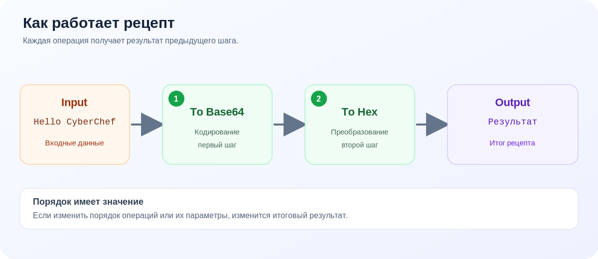

# Справочная информация

**Навигация:** [Главная](index.md) · [Быстрый старт](quick-start.md) · [Установка](installation.md) · [Руководство пользователя](user-guide.md) · [Справка](reference.md) · [Устранение неисправностей](troubleshooting.md) · [Источники](sources.md)

## Основные области интерфейса

| Область | Назначение |
|---|---|
| **Operations** | Список доступных операций и поиск по названию |
| **Recipe** | Упорядоченная последовательность операций и их параметров |
| **Input** | Текст или файл, который требуется обработать |
| **Output** | Результат выполнения рецепта |

Расположение областей схематично показано на иллюстрации [в главной странице](index.md).

## Часто используемые операции

| Операция | Назначение | Пример применения |
|---|---|---|
| `To Base64` | Кодирует данные в Base64 | Представить текст в Base64 |
| `From Base64` | Декодирует данные Base64 | Вернуть текст из Base64 |
| `To Hex` | Представляет данные в шестнадцатеричном виде | Просмотр байтового представления |
| `From Hex` | Преобразует шестнадцатеричное представление обратно | Декодирование Hex |
| `SHA256` | Вычисляет хеш SHA-256 | Проверка целостности / получение контрольного отпечатка |
| `ROT13` | Выполняет ROT13-преобразование букв | Демонстрация симметричного простого преобразования |

Набор параметров зависит от конкретной операции и текущей версии CyberChef. При необходимости найдите операцию в официальном интерфейсе и изучите доступные поля.

## Локальный запуск: команды

### Docker

```bash
docker run -it -p 8080:8080 ghcr.io/gchq/cyberchef:latest
```

Откройте `http://localhost:8080`. Команда запускает готовый Docker-образ и публикует порт приложения на локальном компьютере.

### Запуск из исходного кода

```bash
git clone https://github.com/gchq/CyberChef.git
cd CyberChef
npm install
npm start
```

Команды предназначены для получения исходного кода, установки зависимостей и запуска сервера разработки. Требуется Git и Node.js 24.

## Типовой процесс обработки



1. Подготовить входные данные.
2. Выбрать операцию.
3. Настроить параметры.
4. Проверить Output.
5. При необходимости добавить следующую операцию.
6. Сохранить результат или рецепт.

## Дополнительные ссылки

- [Официальный сайт CyberChef](https://gchq.github.io/CyberChef/)
- [Репозиторий GCHQ CyberChef](https://github.com/gchq/CyberChef)
- [Официальное руководство по запуску](https://github.com/gchq/CyberChef/wiki/Getting-started)
- [Документация Node.js API](https://github.com/gchq/CyberChef/wiki/Node-API)

---
**Навигация:** [Главная](index.md) · [Быстрый старт](quick-start.md) · [Установка](installation.md) · [Руководство пользователя](user-guide.md) · [Справка](reference.md) · [Устранение неисправностей](troubleshooting.md) · [Источники](sources.md)
